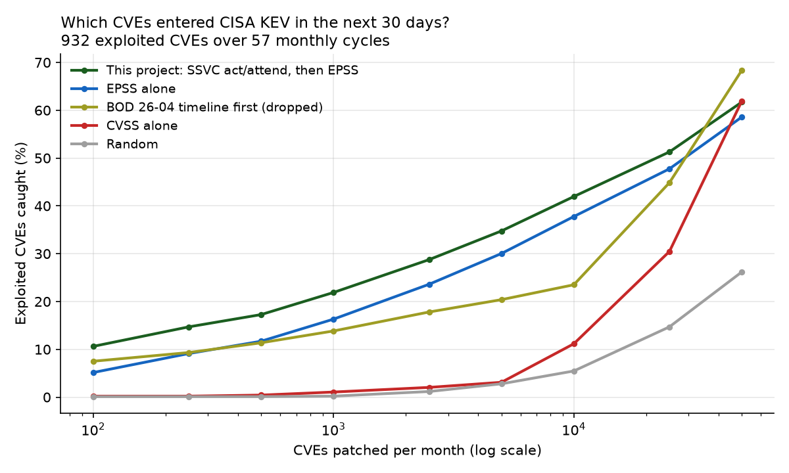
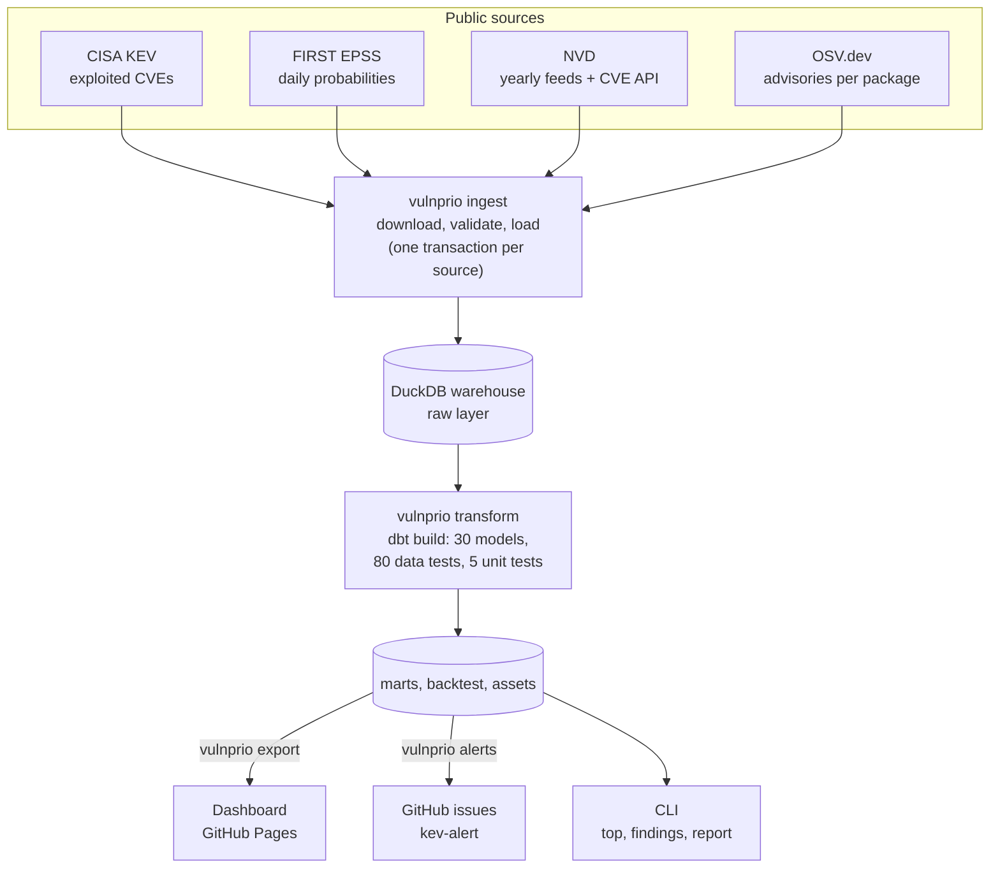
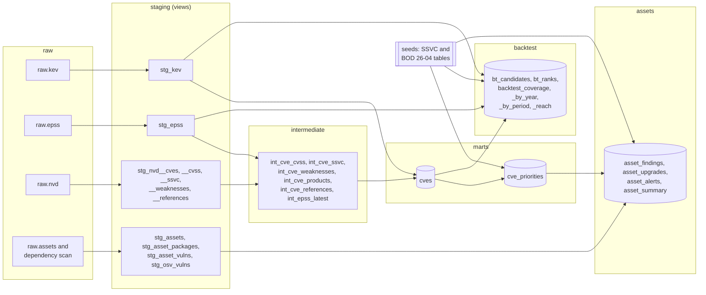
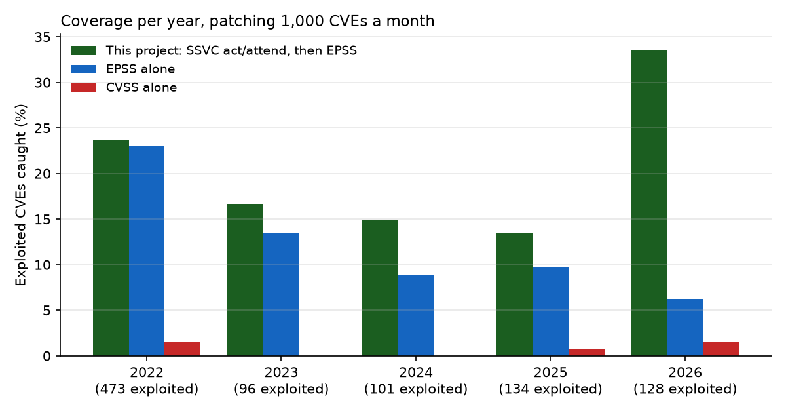

# vuln-priority-pipeline

[](https://github.com/JoaoPedro0305/vuln-priority-pipeline/actions/workflows/ci.yml)
[](https://github.com/JoaoPedro0305/vuln-priority-pipeline/actions/workflows/codeql.yml)
[](https://github.com/JoaoPedro0305/vuln-priority-pipeline/actions/workflows/live-sources.yml)
[](https://github.com/JoaoPedro0305/vuln-priority-pipeline/actions/workflows/daily.yml)
[](https://scorecard.dev/viewer/?uri=github.com/JoaoPedro0305/vuln-priority-pipeline)
[](https://www.bestpractices.dev/projects/15506)

Daily pipeline that ranks CVEs by real-world exploitation risk (NVD + CISA KEV + EPSS),
backtests patching strategies and publishes a live dashboard.

- **Dashboard:** [joaopedro0305.github.io/vuln-priority-pipeline](https://joaopedro0305.github.io/vuln-priority-pipeline/), rebuilt every day
- **Data models:** [dbt documentation](https://joaopedro0305.github.io/vuln-priority-pipeline/dbt/), every table and column with its lineage
- **Latest release:** [v1.0.0](https://github.com/JoaoPedro0305/vuln-priority-pipeline/releases/tag/v1.0.0), with signed build provenance

## The question, and the answer

Tens of thousands of CVEs are published every year and no team patches all of them. The usual
rule is to patch by CVSS severity, but severity measures how bad an exploit *would* be, not how
likely one is. This project measures it:

> With a fixed patching budget, which rule catches the most vulnerabilities that end up exploited
> in the wild?

Replaying 57 monthly decisions (January 2022 to September 2026) with only what was known on each
date: patching the 1,000 highest-CVSS CVEs a month would have caught **1.1%** of the CVEs exploited
the following month, barely better than chance (0.2%). EPSS alone catches **16.3%**. This
project's ranking, CISA's evidence of exploitation first and EPSS after, catches **21.9%**, and
beats EPSS in every year of the period.



## Contents

- [How it works](#how-it-works)
- [Quick start](#quick-start)
- [Data sources](#data-sources)
- [Ingestion](#ingestion)
- [Data models](#data-models)
- [Priority ranking](#priority-ranking)
- [Backtest](#backtest)
- [What the data shows](#what-the-data-shows)
- [Your own dependencies](#your-own-dependencies)
- [Daily run and dashboard](#daily-run-and-dashboard)
- [Command reference](#command-reference)
- [Configuration](#configuration)
- [Quality and security of the repository](#quality-and-security-of-the-repository)
- [Limitations](#limitations)
- [How it was built](#how-it-was-built)

## How it works



Every day a GitHub Actions workflow downloads the sources, validates each file before it touches
the warehouse, rebuilds the models with dbt (a single failed test stops the publication),
publishes the dashboard and opens an issue if a dependency of a tracked system has an exploited
flaw. It costs nothing to run: GitHub Actions and GitHub Pages are free for public repositories.

Repository layout:

| Path | What is there |
|---|---|
| `src/vulnprio/` | The Python package: downloads (`download.py`), one module per source (`sources/`), the warehouse, the CLI, the dashboard export, the backtest report and the issue sync |
| `dbt/` | The data models: staging, intermediate, marts, backtest and assets, with seeds, macros and tests |
| `site/` | The dashboard: three static files, no framework |
| `tests/` | 140 pytest tests, several of which build the whole dbt project on a small warehouse |
| `assets.toml` | The systems whose dependencies are scanned |
| `examples/legacy-web-app/` | An intentionally outdated set of dependencies, to show what findings look like |
| `.github/workflows/` | CI, CodeQL, the daily run, the weekly live check, Scorecard and releases |
| `requirements*.in` / `requirements*.txt` | Direct pins / hash-pinned locks generated from them |

## Quick start

Python 3.11 or newer.

```bash
python -m venv .venv
source .venv/bin/activate        # Windows: .venv\Scripts\activate
pip install --require-hashes -r requirements-dev.txt
pip install --no-deps -e .

vulnprio ingest all                                # KEV, today's EPSS, NVD, dependency scan
vulnprio ingest epss --monthly-since 2021-12-01    # EPSS history, for the backtest (~80 s)
vulnprio transform                                 # dbt build: models and tests
vulnprio top --limit 5                             # what to patch first
vulnprio status
```

The first `ingest all` rebuilds NVD from its yearly feeds (5 to 15 minutes, depending on NVD's
servers); later runs only fetch what changed. `vulnprio status` then shows something like:

```text
source  last load                                 rows  loaded at
epss    2026-10-14                             388,997  2026-10-15 01:32 UTC
kev     2026.10.14                               1,745  2026-10-15 01:32 UTC
nvd     api 2026-10-08T17:19 to 2026-10-15T01:32    11,157  2026-10-15 01:36 UTC

KEV:  1,745 CVEs
EPSS: 60 day(s), from 2021-12-01 to 2026-10-14
NVD:  408,159 CVEs, changes covered until 2026-10-15 01:32 UTC
```

## Data sources

| Source | What it says | Role here |
|---|---|---|
| [CISA KEV](https://www.cisa.gov/known-exploited-vulnerabilities-catalog) | CVEs with evidence of exploitation in the wild, and the date each was added | Ground truth for "was exploited" |
| [FIRST EPSS](https://www.first.org/epss/) | Daily probability of exploitation in the next 30 days, for every CVE | Predictive signal, with history since 2021 |
| [NVD](https://nvd.nist.gov/) | CVSS scores (from NVD and from the CNA), weakness (CWE), affected products (CPE), CISA's SSVC assessments | Severity and context |
| [CISA SSVC tables](https://github.com/CERTCC/SSVC) | The SSVC "CISA Coordinator" decision table and the BOD 26-04 remediation timelines, pinned to a commit | The decision rules |
| [OSV.dev](https://osv.dev) | Known vulnerabilities per package version | Findings in real dependencies |

## Ingestion

`vulnprio ingest kev|epss|nvd|deps|all` downloads each source and loads it into the raw layer of a
DuckDB warehouse (one file, no server). Files are saved exactly as served, then loaded with only
their types fixed; cleaning and joining happen in dbt, where every step is tested.

- **Validate before loading, in one transaction.** KEV: the header count matches the entries, CVE
  ids are well formed and unique, dates parse, and a catalog much smaller than the one loaded is
  refused. EPSS: no duplicates, scores within [0, 1], a minimum row count. NVD: valid ids, dates and
  status on every CVE. A failed check leaves the warehouse as it was.
- **Robust downloads.** HTTPS only, retries with backoff (honouring `Retry-After`), a size limit, a
  SHA-256 for every file, atomic writes, and a minimum speed: a connection that slows to a trickle
  never hits the read timeout, so it is abandoned and started again. NVD feeds do this; one stalled
  at 15 KB/s and then took seconds on a new connection.
- **Provenance.** `raw.load_log` records every load: version, row count, final URL and file hash.
- **EPSS history.** `--monthly-since` loads the first day of each month (or the next published
  day: FIRST skipped 2024-12-01). The file format changed twice since 2021 and all three load.
  Daily scores older than 35 days are pruned except one day per month, so the warehouse does not
  grow by ~140 million rows a year.
- **NVD, full or incremental.** The first run, or a run after 90 days without a sync, loads the 25
  yearly feeds (2002 to now, ~225 MB compressed), each checked against the SHA-256 in its `.meta`
  file and skipped before downloading when unchanged. It then asks the CVE API for what changed
  since the feeds were generated. Later runs only ask the API for changes since the last sync,
  minus a day of overlap (NVD sometimes makes a change visible minutes after its timestamp). A
  stored CVE is only replaced by a version with an equal or later `lastModified`, so loads can
  arrive in any order and be repeated. Requests are spaced 6 s apart, or 0.6 s with the optional
  `NVD_API_KEY`. After a full rebuild the table held exactly the `totalResults` the API reported.

## Data models

`vulnprio transform` runs `dbt build`: every model and its tests in dependency order, so a model
whose tests fail stops everything built on it. About a minute on the full data.



- **staging** unpacks NVD's nested JSON into one row per entry (CVSS score, SSVC assessment,
  weakness, reference) and trims and types everything else.
- **intermediate** holds one decision per model. The main one, `int_cve_cvss`, picks one CVSS score
  per CVE: NVD first (an independent analyst), then the CNA that published the CVE, then anyone
  else; the newer version on ties; v3 as the headline score, since most CVEs have one and the usual
  thresholds (7.0, 9.0) were defined on it.
- **marts.cves**: one row per published CVE (rejected ids left out) with severity, CWE, products,
  KEV status, exploit references, CISA's SSVC assessment and the latest EPSS score.
  **marts.cve_priorities**: the ranking below. Both have enforced **contracts**: the build fails if
  a column disappears or changes type.
- **Tests**: 80 data tests (unique and present keys, accepted values, ranges, every KEV CVE reaching
  the mart, CVSS severity consistent with its score, decision tables complete), source freshness
  thresholds, and 5 unit tests on hand-made rows for the CVSS choice, the priority rules, the
  backtest's point-in-time rules, per-asset decisions and alert selection.

## Priority ranking

`marts.cve_priorities` ranks every published CVE with CISA's own decision tables, kept as dbt seeds:

| Table | Inputs | Output |
|---|---|---|
| SSVC, CISA Coordinator 2.0.3 | exploitation, automatable, technical impact, mission impact | track, track\*, attend, act |
| BOD 26-04 timelines | in KEV, publicly exposed, automatable, technical impact | fix in 3 days (+ forensic check), 3, 14 or 60 days, or at the next upgrade |

`priority_rank` puts known exploitation (KEV) first, then SSVC *act* and *attend*, then EPSS, then
CVSS. The BOD 26-04 timeline is each CVE's deadline, not a sort key. `priority_reason` explains
each position:

```text
$ vulnprio top --limit 3
   rank  cve             product                           fix within        ssvc    why
      1  CVE-2024-3400   Palo Alto Networks PAN-OS         3 days+forensics  act     exploited in the wild (KEV, ransomware); automatable; total control; EPSS 99.9%; CVSS 10.0
      2  CVE-2021-44228  Apache Log4j2                     3 days+forensics  act     exploited in the wild (KEV, ransomware); automatable; total control; EPSS 99.9%; CVSS 10.0
      3  CVE-2019-11510  Ivanti Pulse Connect Secure       3 days+forensics  act     exploited in the wild (KEV, ransomware); automatable; total control; EPSS 99.9%; CVSS 10.0
```

**Where the inputs come from.** CISA assessed about half of all CVEs (197,000). For the rest the
inputs are derived, and the derivation was checked against CISA's answers on the 190,000 CVEs
that have both:

| Input | Derived from | Agrees with CISA |
|---|---|---:|
| Automatable | CVSS vector: network, low complexity, no privileges, no user interaction | 92% |
| Technical impact | CVSS vector: high confidentiality and integrity impact ("total control") | 90% |
| Exploitation | in KEV = active; NVD reference tagged "Exploit" = proof of concept | 88% |

Exploitation takes the **strongest** evidence available, since CISA's assessment can predate the
CVE's addition to KEV. CVEs without any CVSS vector default to "not automatable, partial impact",
and `automatable_source = 'unknown'` says so.

**Organisation inputs.** Mission impact and internet exposure describe your systems, not the
vulnerability. They default to "medium" and "exposed" and can be changed per run
(`vulnprio transform --mission-impact high --publicly-exposed no`) or per system in `assets.toml`.

## Backtest

Each month from January 2022 to September 2026, every strategy ranks all open CVEs **with only
what was known that day**, and the backtest checks which CVEs entered KEV in the following 30
days: 932 of them, among about 238,600 open CVEs per month.

| Strategy | 100 a month (0.04% of open CVEs) | 500 (0.21%) | 1,000 (0.42%) | 5,000 (2.10%) | 10,000 (4.19%) |
|---|---:|---:|---:|---:|---:|
| **This project: SSVC act/attend, then EPSS** | **10.6%** | **17.3%** | **21.9%** | **34.8%** | **41.9%** |
| EPSS alone | 5.1% | 11.7% | 16.3% | 30.0% | 37.8% |
| Act, attend, track\*, then EPSS (dropped) | 9.8% | 15.2% | 19.1% | 30.1% | 37.7% |
| BOD 26-04 timeline first (dropped) | 7.5% | 11.4% | 13.8% | 20.4% | 23.5% |
| CVSS alone | 0.2% | 0.4% | 1.1% | 3.1% | 11.2% |
| Random | 0.1% | 0.1% | 0.2% | 2.8% | 5.5% |

*Share of the CVEs exploited in the next 30 days that each strategy had ranked within the monthly
budget.*

- **CVSS barely beats chance.** At 1,000 a month it caught 1.1%; in 2023 and 2024, none.
  Thousands of CVEs share a 9.8, and severity says how bad an exploit would be, not how likely.
- **EPSS is 15 times better than CVSS** at the same effort, and CISA's evidence of exploitation
  recorded before a CVE reaches KEV (SSVC *act*/*attend*) adds to it.
- **A third of exploitation cannot be caught monthly.** Another 453 KEV additions in the same
  windows (32%) were CVEs published after the decision date. Only faster cycles reach those.

**How the ranking got here.** The first version ordered by the BOD 26-04 timeline, impact before
likelihood; it put ~36,000 "automatable, total impact" CVEs ahead of likely ones and lost to EPSS
alone. The second ranked SSVC *track\** before *track*; from 2025, when CISA recorded thousands of
public proofs of concept, those CVEs (none of which entered KEV within a month) pushed likely ones
down. The final order treats *track* and *track\** alike, as SSVC itself does. All three stay in
the backtest. Because the last change was made after looking at 2025-2026, results are also shown
per period, and the ranking leads in both:

| Strategy, 1,000 CVEs a month | Before 2025 (670 exploited) | From 2025 (262 exploited) |
|---|---:|---:|
| **This project: SSVC act/attend, then EPSS** | **21.3%** | **23.3%** |
| EPSS alone | 19.6% | 8.0% |
| Act, attend, track\*, then EPSS (dropped) | 20.4% | 15.7% |
| BOD 26-04 timeline first (dropped) | 13.7% | 14.1% |
| CVSS alone | 1.0% | 1.1% |



**Point in time.** On each date a CVE is a candidate only if it was published, not yet in KEV and
scored by EPSS that day; it gets that day's EPSS score, and CISA's SSVC assessment only if made
before that day. A dbt unit test fails if any of these rules is removed. Ties are broken by
`md5(cve_id)`, which carries no information.

Reproduce with `vulnprio ingest epss --monthly-since 2021-12-01`, `vulnprio transform` and
`vulnprio report`, which prints these tables and draws the charts.

## What the data shows

**Severity depends on who you ask.** Of 58,491 CVEs scored with CVSS 3.1 by both NVD and the CNA,
75% got different scores, 58% differ by a full point or more, and 30% land on opposite sides of
the 7.0 "high" line.

**NVD now scores a minority of new CVEs.** Share of each year's CVEs by source of their v3 score:

| Published | CVEs | Scored by NVD | Only by the CNA | Only by others (e.g. CISA) | No v3 score |
|---|---:|---:|---:|---:|---:|
| 2022 | 25,073 | 92% | 8% | 0% | 0% |
| 2023 | 28,816 | 92% | 8% | 0% | 0% |
| 2024 | 39,953 | 58% | 28% | 14% | 1% |
| 2025 | 48,152 | 37% | 47% | 16% | 6% |
| 2026 (to October) | 76,299 | 20% | 64% | 16% | 10% |

**SSVC waits for evidence.** At medium mission impact, 1,600 of the 1,605 CVEs that get *act* or
*attend* are already in KEV. Everything else is *track*, and within those the order comes from EPSS.

## Your own dependencies

The same ranking applied to real systems. `assets.toml` lists them (a GitHub repository or a local
folder, its requirement files, and whether the system is internet-facing and how much depends on
it):

```bash
vulnprio ingest deps      # resolve, match against OSV.dev
vulnprio transform        # decide per system
vulnprio findings         # what to upgrade, most urgent first
```

```text
asset                             exposed  impact   packages vulnerable  flaws  fix within
example: legacy web app           yes      high           15          7     84  3 days
brazil-economic-data-pipeline     no       low            19          0      0  -
ssh-bruteforce-analysis           no       low            32          0      0  -
vuln-priority-pipeline            no       low            92          0      0  -

Upgrades, most urgent first:
  example: legacy web app: django 2.2 -> 5.2.17
      fixes 43 vulnerabilities; attend, within 3 days; worst: CVE-2020-7471
  ...
```

The three real repositories have no known vulnerability. The
[legacy web app](examples/legacy-web-app/README.md) is an intentional example with 2017-2019
versions.

1. **Requirement files are untrusted input.** Only package requirements and `-r`/`-c` includes in
   the same tree are accepted (hash-pinned lock files included). Anything that could point pip
   elsewhere (`--index-url`, `--find-links`, `-e`, direct URLs, `../`) is refused with file and line.
2. **Transitive dependencies count.** pip resolves the full set with `install --dry-run --report`,
   for Linux and the system's Python version, **wheels only**: nothing is installed and no package
   code runs. Packages published only as source need their build script run to reveal their
   dependencies; that is allowed only for systems marked `trust_build_scripts`.
3. **OSV.dev** lists the advisories for each version. The same flaw often appears as a GitHub
   advisory, a PyPI advisory and a CVE; they are grouped under the CVE id and cached.
4. **Upgrade targets** come from the advisories' affected ranges, compared with Python's version
   rules (`2.10` > `2.9`): for each package, the version that fixes every known flaw.
5. **A decision per system.** The same CVE can be *act* within 3 days on an internet-facing system
   and *attend* within 14 days on an internal job; a dbt unit test checks exactly that.

**Alerts.** When a dependency has a flaw in KEV, or one whose SSVC decision for that system is
*act*, the daily run opens a GitHub issue labelled `kev-alert` with the decision, the deadline and
the version to upgrade to. The issue is updated when the facts change and closes itself when the
flaw is gone. Alerts are only computed after every dbt test passed, so an issue is never opened or
closed from bad data. Advisory text goes into the issue inside code spans with `@` neutralised, so
it cannot add links, break the table or notify anyone. The job that writes issues holds only
`issues: write` and installs nothing but `requests`.

## Daily run and dashboard

The `daily` workflow runs at 14:30 UTC, after FIRST publishes the day's EPSS scores:

1. **Restore the warehouse** from the Actions cache. If the cache expired, the same commands
   rebuild it (a full NVD load, the EPSS backfill), in about 15 minutes.
2. **Ingest** every source. A failing source does not stop the run; the site is rebuilt with what
   did load, and the last job turns the run red so the failure is noticed.
3. **Save the warehouse** under a new cache key and delete the older ones.
4. **`dbt build`.** A failed test stops everything after it: nothing wrong is published.
5. **Export** the dashboard's data (ten JSON files, ~100 KB), generate the dbt docs, **deploy** to
   GitHub Pages, and **sync the `kev-alert` issues** in a separate job.

**The dashboard** is three static files in `site/` reading that JSON. No framework, no external
script, font or tracker: a Content Security Policy allows only the site's own files. Text from the
sources reaches the page only through `textContent`, never as HTML. Charts are drawn as SVG at the
width they are shown at, follow the system's light or dark mode, use a palette checked for
colour-blind readers, and have their numbers in tables too.

## Command reference

| Command | What it does |
|---|---|
| `vulnprio ingest kev\|epss\|nvd\|deps\|all` | Download and load one source, or all of them |
| `vulnprio ingest epss --date D` / `--monthly-since D` | One EPSS day / one day per month since D |
| `vulnprio ingest nvd --full` / `--years Y..` / `--since D` | NVD full rebuild / some yearly feeds / API changes since D |
| `vulnprio ingest deps --assets FILE` | Scan the systems in another assets file |
| `vulnprio transform [--select S]` | `dbt build` (models and tests), optionally a selection |
| `vulnprio transform --mission-impact M --publicly-exposed E` | Rebuild with other organisation inputs |
| `vulnprio top [--vendor V --product P --since D --limit N]` | The CVEs to patch first |
| `vulnprio findings [--asset A --details]` | Vulnerable dependencies and upgrades per system |
| `vulnprio report [--out DIR]` | Backtest tables and charts |
| `vulnprio export [--out DIR]` | The dashboard's JSON files |
| `vulnprio alerts [--out FILE]` | Findings that warrant an issue |
| `python -m vulnprio.issues --alerts FILE --repo OWNER/NAME [--dry-run]` | Open, update and close the `kev-alert` issues (needs `GITHUB_TOKEN`) |
| `vulnprio status` | What is loaded, and how fresh |

## Configuration

| Setting | Where | Default |
|---|---|---|
| Warehouse file | `VULNPRIO_WAREHOUSE` or `--warehouse` | `data/warehouse.duckdb` |
| Data folder (downloads) | `VULNPRIO_DATA_DIR` | `data/` |
| Systems to scan | `VULNPRIO_ASSETS` or `--assets` | `assets.toml` |
| NVD API key (optional, [free](https://nvd.nist.gov/developers/request-an-api-key)) | `NVD_API_KEY` (a repository secret in Actions) | none: slower API pacing |
| Mission impact, public exposure | dbt variables, `vulnprio transform` options | medium, exposed |
| Backtest start, window, budgets, period split | dbt variables in `dbt/dbt_project.yml` | 2022-01-01, 30 days, 100 to 50,000, 2025-01-01 |

## Quality and security of the repository

A project about vulnerabilities should not be an easy one to compromise.

- **Dependencies pinned by hash.** `requirements*.txt` are locks generated from `requirements*.in`
  with `uv pip compile --universal --generate-hashes`: every package, transitive ones included,
  with the SHA-256 of each published file. If a file on PyPI changes, even under the same version,
  the install fails. Each CI job installs only its own lock.
- **GitHub Actions pinned by commit**, not by tag (a tag can be moved). Dependabot updates both.
- **Least privilege.** Workflows start with a read-only token; write permissions (Pages, issues,
  caches, releases) are granted only to the job that needs them.
- **`ci`:** ruff (including the bandit security rules), 140 tests on Python 3.11 to 3.13 with 96%
  statement coverage (the build fails below 90%), and `pip-audit` on every lock.
- **`codeql`:** static analysis of the Python code, the dashboard's JavaScript and the workflows.
- **`live sources`:** a weekly run against the real CISA, FIRST, NVD, GitHub and OSV.dev
  endpoints, so a format change is caught even when the code does not change.
- **`release`:** on a version tag, the package is built with a hash-pinned builder and published
  with **signed SLSA build provenance**. To check a file:
  `gh attestation verify vulnprio-1.0.0-py3-none-any.whl --repo JoaoPedro0305/vuln-priority-pipeline`.
- **`scorecard`:** [OpenSSF Scorecard](https://scorecard.dev) checks these practices weekly. It
  cannot give full marks for *Code-Review* (one maintainer, and GitHub does not let an author
  approve their own pull request), *Maintained* (the repository is younger than 90 days), *Fuzzing*
  (only detected for other languages) or *Packaging* (released on GitHub, not PyPI).
- **`main` is protected by a ruleset:** changes only through pull requests with every check green,
  no force-push, no deletion, no bypass. The project holds the
  [OpenSSF Best Practices](https://www.bestpractices.dev/projects/15506) passing badge.

## Limitations

- **KEV is a lower bound** of exploitation: it lists what CISA confirmed, with a US-government focus.
- **The ranking is generic** unless you describe your systems: per-system decisions exist only for
  the Python dependencies of the systems in `assets.toml`.
- **The backtest uses today's CVSS** scores and vectors, and only the latest CISA assessment of
  each CVE (one made after a decision date is ignored rather than leaked).
- **EPSS predicts exploitation activity**, not KEV listing, which can lag it.
- **pip evaluates environment markers** (such as `sys_platform == "win32"`) for the machine running
  the scan; the scheduled scan runs on Linux.

## How it was built

In nine stages, one pull request each, every one through CI: KEV and EPSS ingestion, NVD
ingestion, dbt models, the priority ranking, the backtest, the dependency scan, the daily run and
dashboard, the issue alerts, and the supply-chain hardening with the v1.0.0 release. Every change
is listed in [CHANGELOG.md](CHANGELOG.md).

Contributions are welcome: see [CONTRIBUTING.md](CONTRIBUTING.md). Report security problems
privately as described in [SECURITY.md](SECURITY.md).

## License

MIT. KEV is published by CISA; EPSS scores are published by FIRST. This product uses data from the
NVD API but is not endorsed or certified by the NVD.
